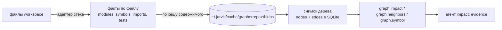

# Знание проекта: стандарты, скиллы, документы, поиск, граф

Jarvis не угадывает, как принято в проекте — он читает это из `.jarvis/` и подаёт агентам
детерминированно (ADR-0020), ищет по индексу с глоссарием (ADR-0015) и считает влияние по графу
кода (ADR-0008, ADR-0021).

## Три вида явного знания

| Вид | Где | Что | Проверяется |
|---|---|---|---|
| Стандарт | `.jarvis/standards/<id>.md` | правило с областью и severity | детерминированно (`standards.check`), семантически (ревью) или оба |
| Скилл | `.jarvis/skills/<id>/{skill.yaml,instructions.md}` | как делать класс изменений | через `verification` (возможности, которые должны пройти) |
| Документ | `.jarvis/knowledge/*.md` | факты: архитектура, домен, соглашения | — |

Личные дополнения в `~/.jarvis/standards/`, `~/.jarvis/skills/` видны только их владельцу и не могут быть
`required`. Проектный скилл с тем же `id`, что у встроенного (`sdd-implementation`, `unit-testing`,
`refactor`), заменяет его.

### Стандарт

```markdown
---
id: no-console
version: 1
title: No console output in library code
scope: { paths: ["src/**"], stacks: [typescript] }
severity: required            # required | recommended
verification:
  kind: deterministic         # deterministic | semantic | hybrid
  check:
    pattern: { glob: "src/**/*.ts", mustNot: 'console\.log' }   # или must: '…'
    # либо tool: project.lint  (возможность, успех которой = проверка; args: {…})
source: { kind: confluence, ref: CONF-1234 }
tags: [logging]
---
Library code writes through the logger, never to the console.
```

`mustNot` судит только строки, которые изменение добавляет относительно базы (`lines: added`, по
умолчанию): правило для нового кода в legacy-проекте не делает нарушением старые строки затронутого файла —
иначе implementation возвращался бы чинить чужое и не мог закончить. `lines: all` — каждая строка изменённого
файла. Без базы (нет git) судится весь файл.

`required` + детерминированная проверка: нарушение в `verify` возвращает `implementation` с исходом
`standards_violation`, нарушения — в loop reasons. Семантические стандарты попадают в контекст агента
ревью, который отчитывается `standardsChecked`. `jarvis standards list|check`.

### Скилл

```yaml
# .jarvis/skills/react-component-change/skill.yaml
id: react-component-change
version: 1
title: Change a React component
appliesTo:
  stacks: [react]
  paths: ["src/**/components/**"]
  kinds: [feature, change]          # feature | change | fix | refactor | test | docs; пусто = любой
  agents: [implementation]          # пусто = implementation
requiredCapabilities: [project.tests]
requiredStandards: ["STD-REACT-*"]  # glob по id; подтягиваются в пакет вместе с скиллом
verification: [project.tests, project.lint]
inputs: [spec, plan]
outputs: [implementation]
```

`instructions.md` рядом — текст для агента. Папка в `.jarvis/skills/` без `skill.yaml` скиллом не считается и
пропускается.

`kinds` сверяется с типом задачи прогона: что выбрал человек (`--kind`, «Тип задачи» в «Новой задаче»), иначе
`kind` workflow (у встроенного `fix` — fix), иначе `change`.

#### Скиллы в формате Agent Skills (`SKILL.md`)

Jarvis читает и открытый формат, который понимают Claude Code, opencode и Codex: папка `<name>/SKILL.md`
с `name` и `description` во front matter. Так у команды и у человека один набор скиллов на все агенты.

Где ищет, по старшинству (одинаковое имя — берётся первый):

1. проект: `.jarvis/skills/`, скиллы из `knowledge.sources`, затем `.agents/skills/` и `.claude/skills/`;
2. встроенные;
3. личные: `~/.jarvis/skills/`, `~/.agents/skills/`, `~/.claude/skills/`.

Что нужно Jarvis сверх формата, кладётся в `metadata`, через запятую:

```markdown
---
name: orders-endpoint
description: Add an endpoint to orders-api
metadata:
  jarvis/agents: implementation
  jarvis/stacks: aspnet
  jarvis/paths: src/**/Api/**
  jarvis/version: 2
---
Steps…
```

Скилл без `jarvis/*` не говорит, где он применим, поэтому сам не подбирается. Зато каждый агент видит его
в разделе «Other skills» пакета — одна строка, имя и описание — и читает через `knowledge.read`, когда тот
подходит. Шаг workflow может назвать его в `skills:` — тогда он идёт целиком. Файлы скилла читаются по
ссылке `skill:<name>/references/x.md`; `scripts/` Jarvis не запускает и не отдаёт.

Личный скилл в provenance пишется как `skill:<id>@user`: его нет в репозитории. `jarvis evals run-to-case`
предупреждает об этом — кейс на другой машине пойдёт без такого скилла; чтобы он воспроизводился,
скилл переносят в `.agents/skills/` проекта.

### Документ знания

```markdown
---
tags: [orders]
paths: ["src/orders/**"]
stacks: [typescript]
agents: [research, specification]
---
# Orders
…
```

Стоит завести документ о границах системы: что в этом репозитории, какие сервисы снаружи и чьи они, как помечены
страницы требований (`… | FRONT`, `… | BACK`). По нему research отделяет свою работу от контрактов других команд
(`dependencies`) и адресует вопросы нужной команде.

Без front matter документ подходит любой задаче. Любой заголовок Markdown (`#`…`######`) начинает новую единицу
индекса.

### Глоссарий

`.jarvis/knowledge/glossary.md` — таблица, не документ для агентов:

```markdown
| термин | синонимы | символы/модули | источники | обновлено |
|---|---|---|---|---|
| повторная регистрация | restart onboarding, re-register | canRestartOnboarding, OnboardingService | CONF-12 | 2026-10-01 |
| заявка | application | Application, applications/ | | |
```

Необязательная шестая колонка `определение` — что термин значит; её выводит `jarvis ask <термин>`.

Термин можно добавить на странице Knowledge → Glossary в `jarvis ui`. Символы сначала сверяются с кодом без модели:
- имя должно встречаться словом в отслеживаемом файле кода;
- путь должен существовать;
- пакет `@scope/pkg` должен быть в `package.json`.

Не найденный символ форма просит подтвердить (Add anyway). Строка дописывается в таблицу в её колонках с сегодняшней
датой, черновиком в рабочей копии, и действует со следующего прогона. Там же видны термины с проблемами: символа нет
в коде, синоним у двух терминов ([ADR-0024](adr/0024-knowledge-in-web-ui.md) §4).

Глоссарий пополняется и из прогонов (ADR-0015 §3). Research и impact записывают в `termLinks` бизнес-термины задачи,
которые в коде называются иначе, и символы, к которым они привели. Когда прогон завершается, связи, которых в
глоссарии ещё нет, становятся кандидатами вида `glossary` — по кандидату на термин, без вызова модели. Если человек
правил research или impact, берутся его связи. Уже предложенное (открытое, принятое или отклонённое) повторно не
предлагается. Принятие (`jarvis candidates promote`) дописывает строку нового термина или новые символы в строку
известного.

Запрос «повторная регистрация заявки после отказа» расширяется до `restart onboarding`,
`canRestartOnboarding`, `application`, `applications/` — детерминированно, с учётом словоформ (основа
термина), и каждое расширение попадает в трассу результата.

### Первичное наполнение: `jarvis onboard`

Для существующего репозитория `jarvis onboard` собирает факты (модули и их зависимости из графа,
документация, тесты, стиль коммитов) и пишет `architecture.md` и `conventions.md` с front matter
`tags: [architecture, generated]` / `[conventions, generated]` и маркером регенерации. Это заготовки только с
проверяемыми фактами; смысл модулей и правила добавляет человек или `jarvis onboard --module <path>` (модуль
или папка внутри него; `--note` — что важно спросившему). Это прогон workflow `onboard-module`: агент
`onboard-mapper` описывает модуль с цитатами, шаг `verify` без модели сверяет цитаты с файлами. Обобщения, которые
цитата не доказывает, помечаются `[check: …]` — их человек проверяет до `promote`. Если не подтвердилось ничего,
кандидата нет и прогон падает. То же — на странице Knowledge → Modules в `jarvis ui`
([ADR-0024](adr/0024-knowledge-in-web-ui.md) §6). Подробности —
[cli.md](cli.md#jarvis-onboard---dry-run---refresh---apply-config---no-graph---module-path---note-текст).

### Документация команды на месте: `knowledge.sources`

Если команда уже держит документацию и инструкции агентам в репозитории (`documentation/`, `AGENTS.md`),
их не нужно копировать в `.jarvis/`: `knowledge.sources` в `project.yaml` читает их на месте, один источник
правды остаётся у команды. Markdown под `path` становится знанием с именем-путём
(`knowledge:documentation/billing/overview.md`), документы по `skills` — скиллами, `scopes` привязывает часть
документации к путям кода (документ вне `scopes` относится ко всему), `AGENTS.md` ниже корня относится к своему
каталогу. Пути из `security.deniedPaths` не читаются. Индекс, `knowledge.read`/`knowledge.search`, `jarvis ask`
и `jarvis mcp serve` видят источники так же, как `.jarvis/knowledge`. `onboard --module` задаёт run область
(артефакт `scope`), поэтому агент получает документацию своего модуля, а не всю.

Зачем: в пилоте агент онбординга по одному коду нашёл механику одного модуля, но почти ни одного правила
использования и ловушки — они были только в документации команды.

## Знание сервисов в репе знаний (ADR-0025)

У сервиса без своей `.jarvis` знание лежит в репе знаний ([configuration.md](configuration.md#репа-знаний-для-многих-сервисов-adr-0025)):
`knowledge/services/<сервис>/*.md` — его документы (там же, где у отдельной репы `.jarvis/knowledge/`),
`knowledge/*.md` — общие для всех сервисов; агенты получают их под именем `common/<файл>`. Глоссарий один на
всех — `knowledge/glossary.md`; стандарты и скиллы — `.jarvis/standards`, `.jarvis/skills` репы знаний. Прогон в
копии сервиса читает то же самое: копия знает репу, из которой сделана. Изменения в репу знаний попадают через PR.

**Стандарты и скиллы по стекам.** В репе знаний на сервисы разных стеков стандарты и скиллы раскладываются
по папкам: `standards/java/`, `standards/frontend/`, `standards/common/`, `skills/java/<id>/`. Рядом с ними
`_scope.yaml` — для кого папка: `stacks: [java]` (или `scope: {…}` / `appliesTo: {…}`; также `paths`, `kinds`,
`agents`). Что задано в самом файле, важнее; папка заполняет пустое, вложенная — поверх родительской. Стек
сервиса jarvis определяет по его репе (`java`, `node`, `typescript`, `react`, …), и агент получает стандарт,
только если его `stacks` пересекаются со стеком сервиса; без `stacks` — получают все. Поэтому `jarvis doctor` и
`jarvis standards list` / `skills list` предупреждают о стандартах и скиллах без стека, лежащих не в папке с
`_scope.yaml` (в пилоте 25 Java-стандартов без scope уходили агентам фронта); `common/` с пустым `_scope.yaml`
— «всем», осознанно. `jarvis standards list --service <имя>` и `skills list --service <имя>` показывают, что
получит конкретный сервис.

**Каталог контрактов.** `jarvis onboard` в сервисе пишет рядом с `contracts.md` машинную часть —
`contracts.json`: эндпоинты, которые сервис отдаёт; вызовы других сервисов (Feign) с адресом, где плейсхолдеры
`${…}` подставлены из `application*.yml`; топики, куда шлёт, и топики, которые читает. Файл всегда пересоздаётся из
кода. Из всех `contracts.json` в памяти строится каталог связей, без модели:
- топик — по имени: кто шлёт → кто читает;
- HTTP — по первому сегменту пути в адресе клиента: `http://${SERVICE_HOST}/<сервис>/…` (или имя клиента, или
  первый сегмент пути) совпал с именем сервиса из карты или с его `services.<имя>.path` — связь с этим сервисом;
  эндпоинт ищется у него по методу и пути (с сегментом и без). Не нашёлся — связь только с сервисом, с пометкой.

Агенты сервиса получают из каталога документ `common/neighbours.md`: кто читает и вызывает то, что сервис отдаёт,
и чем он пользуется у других — карточки, не чужой код. `jarvis knowledge links [--service <имя>]` печатает все
связи списком для проверки человеком (верные, ложные, пропущенные): по нему решается, каким связям доверяет гейт
`scope` (ADR-0025 §7).

**Страница Services в `jarvis ui`.** Вкладка Knowledge → Services есть, когда у `jarvis ui` есть репа знаний (запуск в
ней или в сервисе из карты). Это карта глазами человека, из тех же файлов, что читают агенты, без модели:
- строка на сервис: `kind` и стек; «что это» — первый абзац под заголовком его `architecture.md`; какие проверки
  (tests, typecheck, lint) запускают агенты — `services.<имя>.tools.local` поверх общего `tools.local`; с кем
  связан по каталогу контрактов;
- сверху — что доделать: сервисы без команд, без описания, без репозитория на этой машине (путь задаётся
  `repos.<имя>` в личном конфиге), и кнопка «Onboard» — `jarvis onboard --service <имя>` в репе знаний для тех, у
  кого нет команд; рядом — репозитории возле репы знаний, которых нет в карте;
- справа — схема связей (вызывающий выше вызываемого, топики пунктиром) и список пар с эндпоинтами и топиками.

Страница сервиса (`/knowledge/services?name=<имя>`): описание целиком, команды, контракты — что отдаёт и кому, что
вызывает и у кого, какие топики шлёт и читает, — и последние задачи в этом сервисе; кнопки «Open the description»,
«Onboard», «New task here». Описание сервиса пишет человек: абзац под заголовком `architecture.md` (`onboard` кладёт туда
только факты). Чтобы `onboard --refresh` не пересоздал файл, уберите строку-маркер `jarvis:onboard` — файл
становится вашим; кнопка «Onboard» на странице запускает `onboard` без `--refresh` и готовые файлы не трогает.

## Пакет контекста (EngineeringContextPackage)

На каждый вызов агента резолвер (`src/knowledge/resolver.ts`) собирает пакет по области задачи — стеки
(из `stack`, `stackScopes` или детекции по затронутым путям), пути из impact/plan, тип задачи, id агента:

1. **Скиллы** — все подходящие, отсортированные по специфичности (сколько осей области совпало),
   первые `knowledge.maxSkills` целиком, остальные — ссылками «доступно по запросу» с описанием. Все прочие
   скиллы, включая те, что для других агентов, — каталогом «Other skills», по строке на скилл, в пределах
   5% бюджета; что не влезло, находит `knowledge.search`. Пока пути задачи
   неизвестны (до impact), привязка к путям не считается совпадением: такой скилл или документ встаёт после
   всего, что подходит наверняка, и не вытесняет общие скиллы.
2. **Стандарты** — подходящие по области плюс `requiredStandards` выбранных скиллов.
3. **Документы** — подходящие по front matter; если их больше `knowledge.retrieval.rankAbove`, порядок
   задаёт индекс по запросу из задачи и требований (событие `retrieval.knowledge`), ничего не
   отбрасывается — не влезшее становится ссылкой.

Пакет рендерится слоем L4 с долями бюджета `knowledge.split`. Ссылки читаются агентом через
`knowledge.read` (`knowledge:name`, `standard:ID@v`, `skill:id@v`, `artifactId@v`) и записываются в
provenance артефакта. `jarvis mcp serve` → `context.inspect` показывает точный пакет для задачи.

## Поиск (ADR-0015)

Индекс в SQLite (миграция 0004): единицы — секции документов, стандарты, скиллы, артефакты run
(research, requirements, spec, impact, plan, review, clarification, release-notes) и код. Каждая единица
версионируется хешем содержимого: переиндексируется только изменившееся, удалённое вычищается.

**Код.** Файлы исходников, которые отслеживает git (`git ls-files`, то есть с учётом `.gitignore`), режутся на
единицы по символам: объявление верхнего уровня (функция, класс, тип, константа) вместе с комментарием над ним, а
длинный класс — по методам. Окна по 100 строк — только у файла без объявлений и у слишком длинного метода. Ссылка
единицы — `путь:начало-конец`, её читает `knowledge.read`. Версия единицы — blob sha файла: при обновлении индекса
читаются только файлы, которые git считает изменёнными (правка в рабочей копии тоже). Не индексируются
`node_modules`, `vendor`, `dist`, `build`, `generated` и подобные папки, `*.min.js`, `*.d.ts`, бинарные и большие файлы,
запрещённые пути (`security.deniedPaths`); текст проходит Redactor. Идентификаторы разбиваются на слова
(`canRestartOnboarding` находится и по «restart onboarding»), а глоссарий расширяет запрос до символов кода — поэтому
«повторная регистрация» находит функцию. Векторов у кода нет до решения гейта ADR-0015 §6. Настройка —
`knowledge.retrieval.code` (см. configuration.md): `false` выключает код в индексе, `include`/`exclude` — глобы от
корня, `maxFiles`, `maxFileBytes` ограничивают размер.

- **Лексический** индекс — FTS5 с bm25, всегда.
- **Семантический** — векторы через `Embedder` (OpenAI-совместимый `/embeddings`, модель из
  `knowledge.retrieval.embeddings`), ключ `(единица, версия, embedder)`: другой embedder — другой индекс.
  Выключен по умолчанию до прохождения гейта ADR-0015 §6.
- **Слияние** — Reciprocal Rank Fusion (k = 60); у каждого результата `retrievalPath`
  (`[{index: lexical, rank: 1}, {index: semantic, rank: 3}]`).

Агентам доступны `knowledge.search` (фильтр `kinds`, например `["code"]`) и `knowledge.read`; человеку —
`jarvis knowledge index|search|eval` и справочник `jarvis ask` (термины из глоссария, ответ по базе с проверенными
цитатами; код ему не показывается); IDE — `knowledge.search` через MCP.

**Качество поиска** (ADR-0015 §6) меряет `jarvis knowledge eval` на размеченном наборе
`evals/retrieval/cases.yaml`:

```yaml
cases:
  - id: restart-after-rejection
    query: повторная регистрация после отказа
    expected: [src/onboarding.ts, knowledge:onboarding]   # файл (любая его единица), путь:строка, ref знания
```

Печатаются Recall@5, Recall@10, MRR, доля нерелевантного в первой десятке и токены выдачи, а также гейт: Recall@10
против цели 0.9. Результат пишется в `evals/results/<дата>-retrieval.json`; `--baseline` фиксирует его в
`evals/baseline/retrieval.json`, следующие прогоны сравниваются с ним и при падении больше допуска (`--tolerance`,
по умолчанию 5 %) выходят с ненулевым кодом. `--no-glossary` ищет без расширения по глоссарию — так видно, что
даёт глоссарий. Embeddings и reranker добавляются только если гейт не пройден и промахи — межъязыковые.

## Граф проекта (ADR-0008, ADR-0021)



- Факты извлекаются по файлу и кэшируются по его хешу — общие для всех веток и worktree; снимок
  строится на дерево git; хранятся последние 5.
- Шаг `discover` перед агентами сам приводит граф в порядок для дерева run (из кэша это быстро; событие
  `graph.update` с `trigger: discover`), а идентификатор репозитория для worktree совпадает с основным
  checkout, поэтому снимок проекта виден из worktree run.
- `jarvis knowledge update` — инкрементально; `--full` без кэша. `jarvis knowledge status --verify`
  пересчитывает и сравнивает: граф детерминирован или тест падает.
- Агент `impact` использует `graph.impact(paths)` и `graph.neighbors(symbol)` как доказательства и явно
  говорит, когда снимка нет.
- Импорты разрешаются на уровне дерева: относительные — ядром, остальное — резолвером адаптера. TS-адаптер
  берёт `paths`/`baseUrl` ближайшего к файлу `tsconfig.json` (с `extends`, комментариями) и пакеты
  workspace-монорепо (`workspaces` корневого `package.json`): `@acme/lib/billing` через `exports` пакета
  (`./*` → `./.publish/*.js`) отображается обратно в `packages/lib/src/billing/index.ts`. Внешние пакеты
  остаются узлами `pkg:<имя>`. Без этого правка библиотеки не находила затронутые приложения.
- Адаптер, который знает классы и методы (Java), добавляет узлы типов и методов и рёбра `EXTENDS`,
  `IMPLEMENTS`, `CALLS`. `graph.impact` идёт и через супертипы: изменение реализации достаёт тех, кто держит
  её интерфейс (но не другие реализации). Тест, который обращается к контроллеру по URL (MockMvc), связан
  с ним по пути. `graph.symbol(name)` — класс или метод по имени (`OrderService`, `OrderService.find`): где
  определён, супертипы, реализации, кто вызывает (и через интерфейс), что вызывает — одним вызовом вместо
  поиска.

### Уровни возможностей

Первый шаг `sdd` — `discover` — пишет артефакт `project-capabilities`: стеки (заданные и
обнаруженные), области полиглот-репозитория, адаптеры, эффективные команды (`tests`, `typecheck`,
`lint` — из `tools.local` или адаптера), откуда каждая возможность, и уровень:

| Уровень | Условие | Следствие |
|---|---|---|
| FULL | адаптер языка: граф + code intelligence + диагностика | impact по графу, точные проверки |
| BASIC | нет адаптера, но есть команды проекта; или сама репа знаний (ADR-0025) без команд | работает на тексте и `project.*` |
| UNSUPPORTED | нет ни адаптера, ни команд (кроме репы знаний) | run останавливается с `policy:` причиной |

На Windows команды `tools.local` идут через `cmd.exe`; слово команды, начинающееся с `./` или `../`
(`./gradlew test`), запускается как `.\gradlew test` — `project.yaml` остаётся общим для всех ОС.

Адаптеры: TypeScript (`src/adapters/typescript`, ts-morph). Остальные стеки — BASIC. Как добавить —
[extending.md](extending.md#адаптер-языка-adr-0021).

## Кандидаты в знание (ADR-0020 §6)

Кандидатов предлагают агенты `review` и `review-analysis` (правило, которое стоило бы зафиксировать) и
`onboard --module` (карта модуля), а завершённый прогон — термины глоссария. Они хранятся артефактами `candidate` и
ждут человека. Виды:
- `standard` — пишется как `severity: recommended`, `verification: semantic`;
- `knowledge` — документ в `.jarvis/knowledge/`;
- `skill-improvement` — правка скилла: кандидат обязан назвать скилл (`skill: <id>`), иначе он не создаётся
  (событие `candidate.dropped`). Принятие дописывает предложение в конец `instructions.md` этого скилла и поднимает
  `version` в `skill.yaml` — агенты получают новую версию со следующего прогона, в provenance видно `skill:id@v`.
  Встроенный скилл сначала копируется в `.jarvis/skills/<id>/` и дальше его заменяет. Скилл из документации
  команды или `~/.jarvis/skills` так не правится — его меняют там, где он лежит. `jarvis candidates show` показывает
  конец инструкции и добавляемые строки;
- `glossary` — термин и символы кода, которые связал завершённый прогон (см. «Глоссарий»); принятие пишет в
  `glossary.md`.

Команды: `jarvis candidates list|show`, `promote <имя> [--id file-id] [--replace]`, `reject <имя>`. Файл,
сгенерированный Jarvis (с маркером), заменяется без вопросов; написанный человеком — только с `--replace`.

То же в `jarvis ui`: карты модулей решаются на Knowledge → Modules, остальные кандидаты — на Knowledge →
Candidates. Там список открытых (новые сверху, «С решёнными» показывает и прочие), у кандидата — что он
предлагает, evidence и что именно запишет принятие: файл стандарта или знания (имя можно поменять; файл,
который написал человек, заменяется только с отметкой), скилл и его версия «v1 → v2», термин глоссария.
Отклонить можно с причиной — она сохраняется вместе с решением. Кандидаты сохраняются всегда: принять или
отклонить их решает человек.
