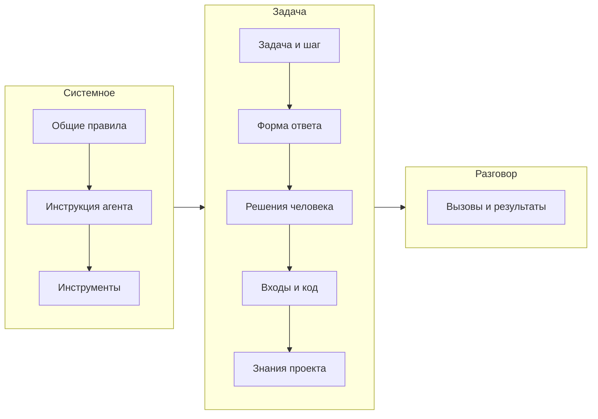
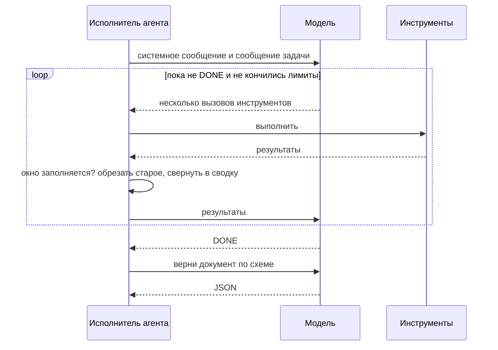

# Как промпт настраивает агента

Поведение агента определяет его промпт. Jarvis собирает его заново на каждом шаге из нескольких частей: общих
правил, инструкции агента, формы ответа, состояния задачи, входных документов и знаний проекта. Большую часть
этого вы можете менять, не трогая код Jarvis.

## Из чего собирается промпт

Модель получает два сообщения: системное и сообщение задачи. Дальше к ним добавляется разговор: вызовы
инструментов и их результаты.



Системное сообщение не меняется в течение шага. Если шлюз модели кэширует начало промпта, каждый следующий вызов
не платит за него заново.

### Общие правила

Одинаковы для всех агентов. Если кратко:

- работать только через перечисленные инструменты, другого мира нет;
- сначала доказательства: читать файлы, прежде чем утверждать, и указывать пути и строки;
- независимые чтения и поиски просить одним ходом, параллельно;
- не придумывать содержимое файлов, API, тикеты и результаты тестов: что нельзя проверить, то неизвестно;
- секреты видны как метки `[REDACTED:…]`, восстанавливать их нельзя;
- отказ политики окончательный, обходить его другими аргументами нельзя;
- не создавать в рабочей копии черновых файлов: всё записанное станет частью изменения;
- порядок важности: эти правила и инструкция агента, потом обязательные стандарты, потом скиллы, потом
  рекомендованные стандарты и документы;
- закончив работу, ответить одной строкой `DONE`, а документ отдать, когда его попросят.

Если в настройках задан язык, сюда же добавляется правило: всё, что читают люди, писать на этом языке, а ключи
JSON, имена из кода, пути и цитаты оставлять как есть.

### Инструкция агента

Цель агента и способ работы, несколько абзацев. Например, у исследователя: что считается фактом, а что
предположением, где искать, как отличить работу этого репозитория от контракта с чужой системой, когда
остановиться. Тексты всех встроенных инструкций — в `src/agents/builtin/index.ts`.

### Форма ответа

Схема JSON документа, который агент должен вернуть, и список допустимых исходов. Исход управляет сценарием:
«готово», «нужно исследовать ещё», «код надо исправить». Документ, который не прошёл схему, Jarvis пытается
починить ограниченное число раз, а потом шаг падает с сохранённым неправильным ответом, чтобы его можно было
разобрать.

### Решения человека и причины возврата

Всё, что человек решил в этой задаче, попадает сюда как обязательное:

- комментарий, с которым задачу вернули к этому шагу;
- почему шаг идёт снова: какие тесты упали, какие стандарты нарушены, что нашло ревью;
- принятые правила из разговоров с агентом;
- комментарии к утверждённым документам;
- заметки, оставленные на ходу.

Если человек вернул документ, первым во входах идёт его прошлая версия: агент правит её, а не начинает заново.

### Входы и код

Документы предыдущих шагов, которые нужны этому агенту: исследование, спецификация, план. Они укладываются в
бюджет. Что не поместилось, агент видит списком и может прочитать по запросу. Реализация ещё получает текущий
пункт плана вместе с текстом его файлов, а все агенты — код, который уже читали раньше в этой задаче.

### Знания проекта

Пакет скиллов, стандартов и документов, отобранных под эту задачу, эти файлы, этот стек и этого агента. Бюджет
пакета делится между ними, по умолчанию 40% скиллам, 35% стандартам и 25% документам. Скиллов берётся не больше
двух. Остальное подходящее перечислено и доступно по запросу, а все прочие скиллы проекта — коротким списком с
описаниями. Подробно — на странице [скиллы](../setup/skills).

## Как идёт разговор



По дороге Jarvis подправляет агента короткими сообщениями, когда видит типичные сбои:

- тот же поиск снова пуст — «это уже искали, текста здесь нет, ищи другое имя или в другом месте»;
- тот же файл читается снова без изменений — «ты уже читал, текст выше» вместо повторного текста;
- реализация долго только читает — «хватит читать, начни открытый пункт плана», а потом остановка;
- ответ обрезан лимитом вывода — «делай вызовы меньше, одна правка за раз».

## Что можно настроить

### Свою инструкцию агенту

Файл `.jarvis/agents/<агент>.md` заменяет встроенную инструкцию целиком. Общие правила, форма ответа, исходы и
инструменты остаются прежними: поменять, что агент может, так нельзя, можно поменять, как он работает.

Удобно начать с копии встроенного текста и поправить нужное:

```markdown
You are the review agent of Jarvis.
Goal: decide whether the change satisfies the specification and the project's conventions.
Method:
- Read the diff of the workspace against its base (git.diff). Check every requirement's acceptance criteria
  against the code and the test results.
- In this project every new endpoint must have an integration test in tests/api/. A missing one is a finding
  with severity major.
- ...
Produce the result document.
```

Имя файла — идентификатор агента: `research`, `requirements`, `specification`, `impact`, `plan`,
`implementation`, `test`, `docs`, `telemetry`, `review`, `review-analysis`, `release-notes`, `onboard-mapper`,
`knowledge-answerer`, `split`.

Свою инструкцию стоит писать, когда правило касается того, как агент работает, а не того, как устроен проект. Факты
о проекте лучше класть в знания: их получат все агенты, кому они нужны, а не только один.

### Скиллы, стандарты и документы

Это основной способ влиять на агентов, и он не требует трогать инструкции.

- **Скилл** с `appliesTo.agents` (в `SKILL.md` — `jarvis/agents`) попадает целиком только к нужным агентам и только
  когда подходит стек, пути или тип задачи. Шаг сценария может назвать свои скиллы явно.
- **Документ** с `agents:` в шапке — только этим агентам, с `paths:` — только когда задача касается этих файлов.
- **Обязательный стандарт** весит больше скиллов, а нарушение с проверкой кодом возвращает реализацию.

Подробно — в [знаниях проекта](../guide/knowledge).

### Язык, глубину рассуждения, лимиты, модель

```yaml
language: ru
agents:
  requirements:   { reasoningEffort: high }
  implementation: { reasoningEffort: low, limits: { maxToolCalls: 120 } }
  research:       { onLimit: ask }      # на лимите спросить, а не закончить с тем, что есть
roles:
  review: { models: [strong-model] }
```

### Посмотреть, что агент получил на самом деле

```sh
JARVIS_LOG=debug jarvis work ABC-42
jarvis logs <задача> --event model.request
```

В подробном режиме технический журнал пишет промпт каждого вызова: первый целиком, дальше только новые сообщения.
В нём есть код проекта, поэтому этот режим не стоит включать без надобности на общих машинах.

Что из знаний агент видел, записано и без подробного режима: рядом с каждым документом задачи хранится список
скиллов, стандартов и документов, на которые он опирался.
