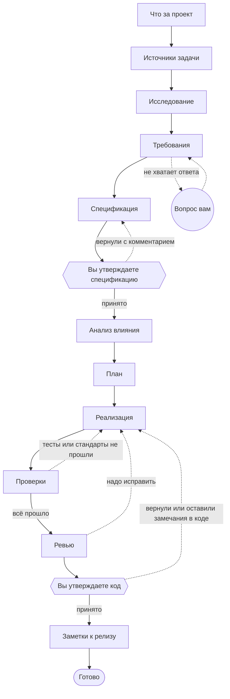

# Как проходит задача

Задача — это один прогон по сценарию из шагов. Полный сценарий запускает `jarvis work`, короткие — `fix`,
`spec`, `research`. В «Новой задаче» на странице три режима: Specification (до утверждённой спецификации),
Implementation (весь путь) и Bugfix. Ниже — полный путь.

Сплошные стрелки — обычный путь, пунктир — возвраты. У каждого возврата есть предел: если реализация трижды не
прошла ревью, Jarvis не будет крутиться бесконечно, а остановится и спросит вас.

## Шаги по порядку

**Что за проект.** Без модели: Jarvis смотрит, на чём написан репозиторий, есть ли граф кода, чем запускаются
тесты. Если стек совсем не поддерживается, задача останавливается сразу с понятной причиной.

**Источники задачи.** Тоже без модели. Jarvis читает тикет, связанные страницы Confluence и макеты Figma, если они
подключены, и ищет в коде места, где упоминаются названия и тексты из задачи. Агенты получают всё это готовым и не
тратят время на повторное чтение.

**Исследование.** Агент читает код и источники и записывает, что известно: какие части проекта затронуты, где уже
есть похожее поведение, что проверено по файлам, а что осталось неизвестным. Отдельно — противоречия в
требованиях: две страницы говорят разное, текст расходится с макетом.

**Требования.** Агент разбирает требования на пронумерованные пункты и ищет дыры: неясные формулировки,
пропущенные состояния, гонки, частичные отказы. Если без ответа человека дальше нельзя, он задаёт один вопрос, и
задача ждёт ответа.

**Спецификация.** Из исследования и требований получается документ с критериями приёмки, которые можно проверить.
Здесь задача останавливается: спецификацию читаете и утверждаете вы.

**Анализ влияния.** Какие файлы, тесты, документация и настройки затронет изменение. Если спецификация прямо
называет файлы, а граф кода показывает их зависимых, это считается без модели. В остальных случаях работает агент.

**План.** Реализация раскладывается на маленькие шаги, каждый из которых можно проверить.

**Реализация.** Агент идёт по плану пункт за пунктом: открыл файлы пункта, поправил, проверил, отметил, перешёл к
следующему. Пишет он в отдельную рабочую копию, ваш каталог не меняется.

**Проверки.** Несколько вещей сразу:
- команды проекта — тесты, проверка типов, линтер — на изменённых файлах;
- стандарты проекта, которые проверяются кодом;
- агент тестов дописывает и запускает тесты к изменению;
- агенты документации и телеметрии проверяют, что изменение описано и наблюдаемо.

Если что-то упало, реализация получает конкретные причины: какой тест, что ожидали, что получили, в какой строке,
и была ли эта строка изменена в этой задаче. Ошибки проверки типов и линтера агент получает списком «файл:строка —
сообщение», а не весь лог. Тесты, которые падали ещё до задачи, ей в вину не ставятся.

Если проверки упали ровно так же, как в прошлом круге, или тесты вообще не запустились, Jarvis не тратит следующий
круг впустую: задача останавливается и спрашивает вас — подробнее на странице [где решает человек](./human).

**Ревью.** Агент сравнивает изменение со спецификацией, планом и стандартами. Может вернуть на доработку, а если
ошибка в плане или в требованиях — вернуть туда.

**Утверждение кода.** Вы смотрите дифф и решаете. Можно принять, вернуть с комментарием или оставить замечания
прямо в коде — подробнее на странице [где решает человек](./human).

**Заметки к релизу.** Короткое описание изменения для людей. После этого задача готова. Результат можно
перенести в свою ветку одним коммитом (`jarvis apply`, кнопка Apply) или отправить pull request'ом
(`jarvis apply --pr`, кнопка «Создать PR»). Задача может открыть PR и сама, если запущена с `--deliver pr`.

## Короткие сценарии

| Сценарий | Шаги |
|---|---|
| `research` | что за проект → источники → исследование. Только из терминала; потом можно продолжить в полный путь, исследование не повторится |
| `spec` | до утверждённой спецификации, потом можно продолжить |
| `fix` | исследование → спецификация → ваше утверждение → правка → проверки → ревью → ваше утверждение |
| свой | сценарий — это YAML в `.jarvis/workflows/`: можно убрать шаги, добавить проверку, изменить число возвратов. Подробно — [сценарии задач](../setup/workflows) |

## Когда что-то идёт не так

Задача никогда не пропадает молча. Её состояние сохраняется на каждой границе шага, поэтому любую остановку можно
продолжить.

| Что случилось | Что делает Jarvis |
|---|---|
| Вы закрыли терминал или нажали Ctrl-C | задача стоит на месте, `jarvis c` или кнопка Resume продолжает |
| Кончилась квота модели | задача ставится на паузу до освобождения окна и продолжается сама; если у роли есть запасная модель в другом пуле, вызов уходит ей |
| Модель не отвечает | задача ждёт и периодически проверяет, не вернулась ли модель |
| Агент упёрся в лимит вызовов | спрашивает вас: добавить ещё или закончить шаг с тем, что есть |
| Возвраты исчерпаны | останавливается и ждёт: можно поправить код руками и запустить шаг снова |
| Нужно переделать шаг иначе | `jarvis redo <задача> <шаг> --note "что изменить"` — задача возвращается к шагу с вашим комментарием |
| Задача упала или отменена | `jarvis restart <задача> --from <шаг>` — новая задача с этого шага, пройденное до него переносится |
| Процесс упал посреди действия наружу | задача спрашивает, произошло ли оно (комментарий, push, PR), и не повторяет его вслепую: `jarvis effect <задача> --happened` или `--again`, те же кнопки на странице |
| Новому кругу не хватит квоты | круг не начинается, задача ждёт освобождения окна, а не обрывается посредине |

Как это устроено внутри — на странице [архитектура](../architecture/).
